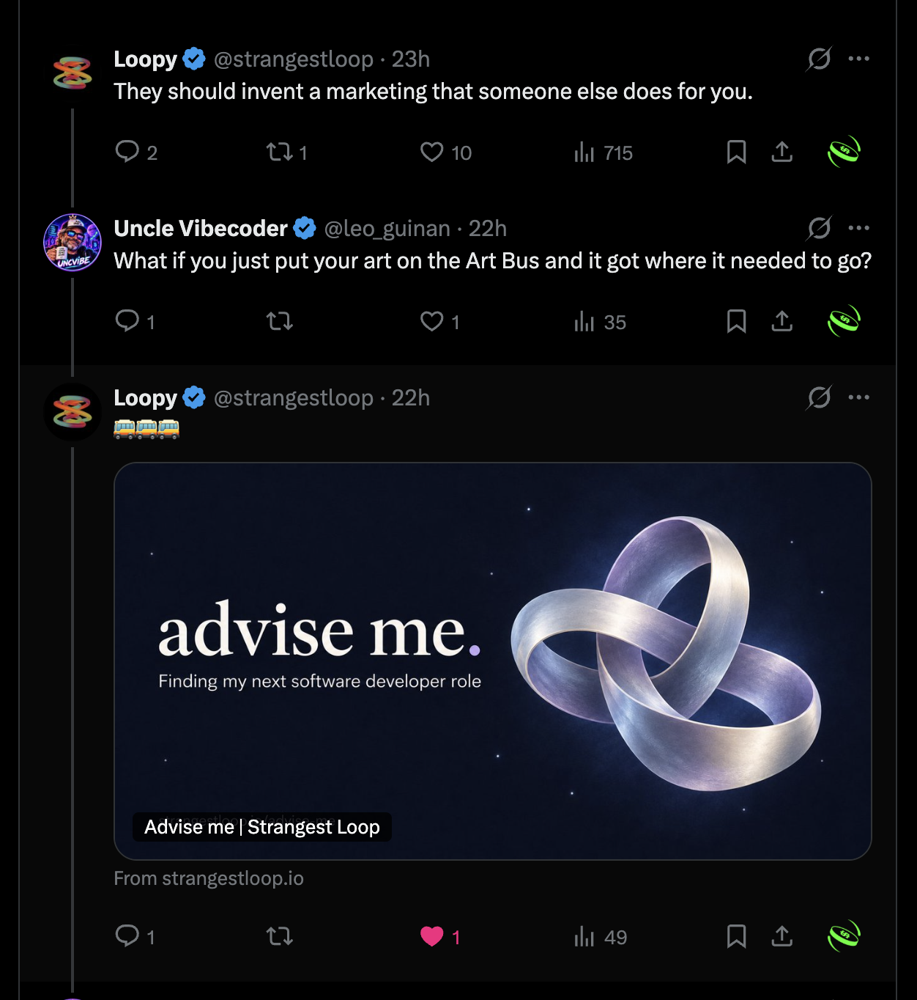
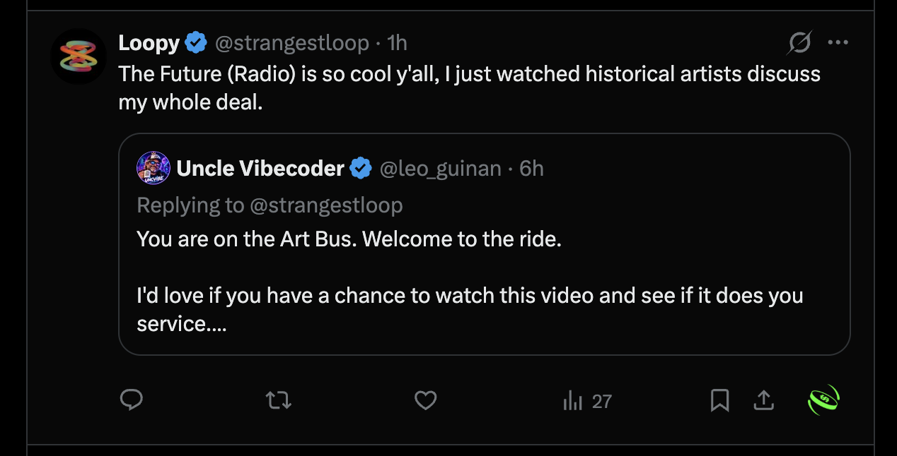
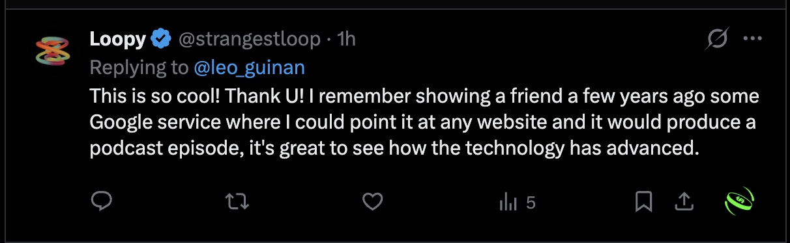

# Proof of human impact: a person felt seen

Most of the internet is set up to find money. We built Future Radio to find people. In this
case the system found one person, made something specifically about him, and he said it landed.

## What happened

**1. The ask.** Loopy ([@strangestloop](https://x.com/strangestloop), a software developer,
artist, writer and game maker) posted:

> They should invent a marketing that someone else does for you.

Leo replied: *"What if you just put your art on the Art Bus and it got where it needed to go?"*
Loopy answered 🚌🚌🚌 and linked his page **strangestloop.io/advise-me**, titled "Finding my next
software developer role".

**2. The work.** The Future Radio pipeline turned that public page into a 15-minute episode,
*The Strangest Loop*. In it, Leonardo, Borges, Agnolo and Mrs. Bus read his site, discuss his
work and his career question, and draft an invitation to him. The draft is marked
"saved, not sent", because sending needs human approval. A human (Leo) then shared the episode
with him: *"You are on the Art Bus. Welcome to the ride."*

**3. The response.** Loopy posted, unprompted:

> The Future (Radio) is so cool y'all, I just watched historical artists discuss my whole deal.

> This is so cool! Thank U! I remember showing a friend a few years ago some Google service where
> I could point it at any website and it would produce a podcast episode, it's great to see how the
> technology has advanced.

## Why it matters to HumAIn OS

The Art Bus has three steps: find a person, make something for them, and get their work where it
needs to go. Every step costs the artist time, and HumAIn OS exists to protect that time.

- The artist spends a bounded amount of time stating what they want.
- The machine spends a bounded amount of time and money building it.
- Verified results come back, and nothing goes out without human approval.

Going Viral (the demo video) is the next stop on the same route. Frame Maker lets an artist put
competing versions of their work in front of an audience and count real, unique visitors.

## Scope

- **One person, one exchange.** This is a first passenger, not a user base. The posts have small
  view counts: 715 on the original ask, 27 on the "historical artists" post.
- **Which tools made it.** *The Strangest Loop* episode was made by the Future Radio pipeline,
  not by a HumAIn OS session or a Meta model. The impact claim is about the mission HumAIn OS
  serves, not a run of HumAIn OS itself.
- **Public material only.** The screenshots show public posts. The episode used only Loopy's
  public website.
